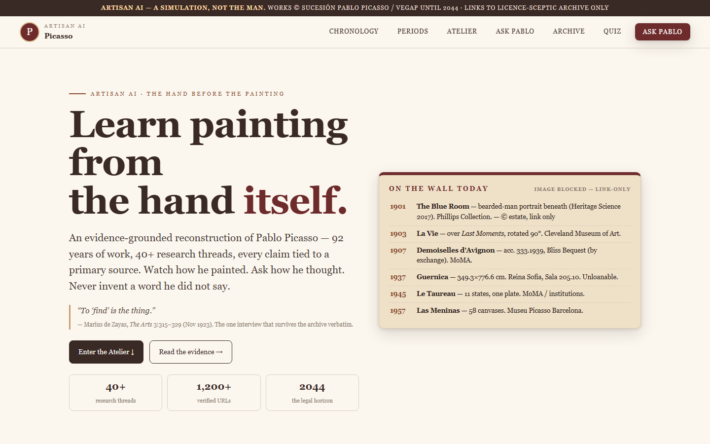
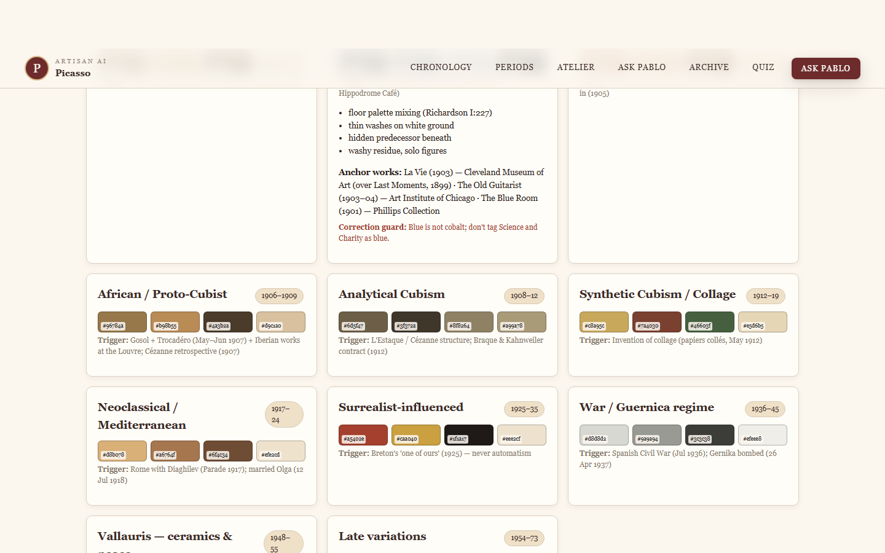
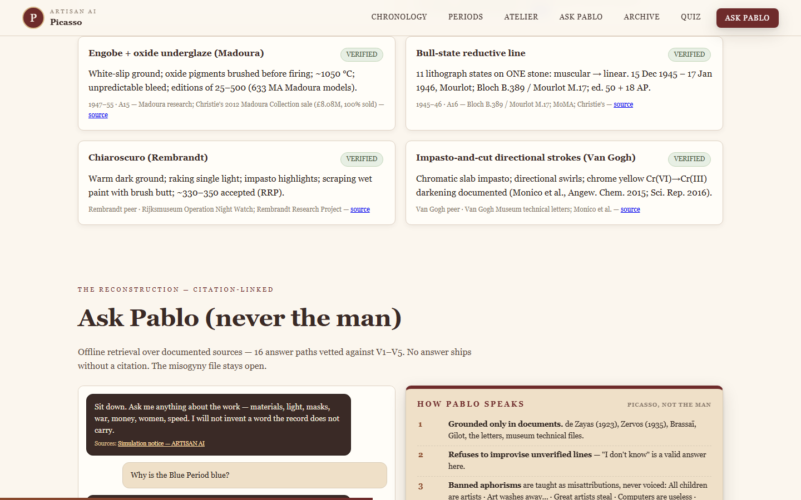
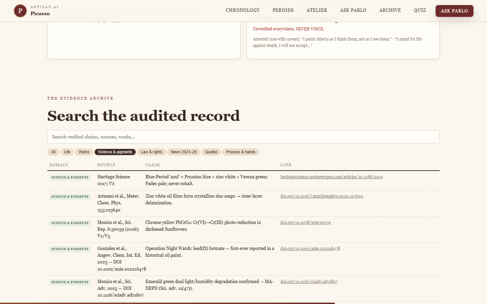
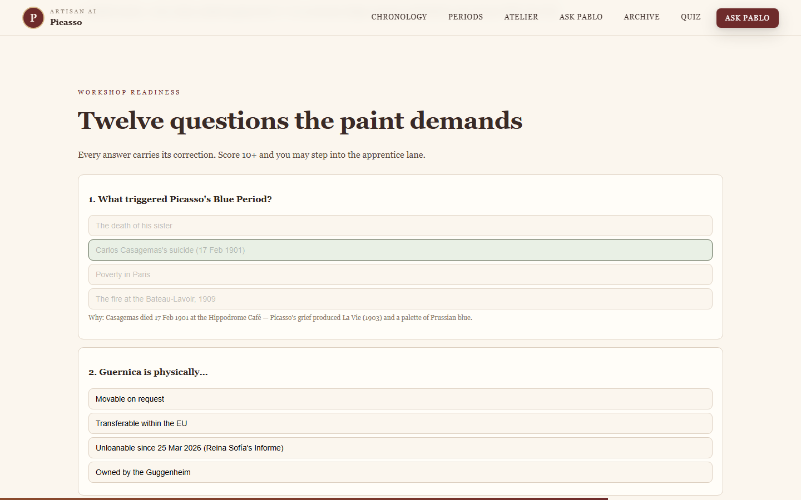

# 🏺 ARTISAN AI — Picasso · _The Hand Before the Painting_

> ✨ **A Living, Evidence-Grounded Reconstruction of Pablo Picasso** — observe his documented process, interrogate an archive trained on primary sources, and never hear an invented word.
> 🔒 **Status:** Live & verified · 🎨 **Class:** Historical museum reconstruction (not a game, not a "generative paint" app)

<p>
  <a href="#-verified-visual-ui-gallery">Gallery</a> ·
  <a href="#features">Features</a> ·
  <a href="#method--evidence">Method</a> ·
  <a href="#run-it-locally">Run</a> ·
  <a href="#rights--ethics">Rights</a>
</p>

---

## 🚀 Live demo

> ### 👉 **Hosted app:** `https://artisan-ai-picasso.vercel.app` _(updated on every deploy to main)_
> _(Final URL written at deploy time — 2026-11-19)_

> ⚠️ **Legal note:** This is a **simulation, not the man**. No Picasso image reproduces anywhere (© Sucesión Pablo Picasso / VEGAP until 1 Jan 2044; moral rights perpetual). The persona is a citation-linked reconstruction of documented sources — interviews, letters, memoirs, museum and conservation technical files — and is silent until licensed by the estate for any public-voice use.

---

## 🖼️ Verified Visual UI Gallery



**01 — Hero:** "Learn painting from the hand itself." Rights ribbon visible above the fold; museum-plaque card listing verified records.

| | |
| :--- | :--- |
|  |  |
| **02 — Atelier:** Regime explorer + Bull scrubber (11 states) | **03 — Ask Pablo:** Offline retrieval answers with citations |
|  |  |
| **04 — Evidence archive:** live search + 7 domain filters | **05 — Workshop readiness:** per-question corrections |


**06 — Full page:** chronology · regimes · atelier · Ask Pablo · plates · quote ledger · archive · quiz · footer.

---

## ✨ Features

| Module | What it does | Verified by |
| :--- | :--- | :--- |
| **Chronology** | 1881→2026, corrections applied (Sala 205.10; IB-952; `dation` 1979) | V1 verification |
| **Regimes explorer** | 11 cited regimes with indicative palettes + "correction guards" | A2; V1 |
| **Bull States** | Illustrative SVG 11-state scrubber (mourlot, Dec 1945–17 Jan 1946) | A16 |
| **Technique cards** | VERIFIED / UNVERIFIED chips — nothing prints without V1–V5 | A3; V1–V5 |
| **Ask Pablo** | 16 documented-Q/A retrieval; every answer ≥1 citation or refusal | A8; V1 |
| **Evidence archive** | Searchable verified-claims ledger (7 domains) | A11, A25, V1–V5 |
| **Quote ledger** | Documented vs banned (eight un-voicing rules) | A8; V1 |
| **Workshop readiness** | 12-question quiz with corrections | D2; V5 |

## 🧠 Method & evidence

This app is baked out of **2 research waves: ~35 parallel agents + 5 adversarial verification agents** (~120,000 words) compressed into a master dossier PDF:

```
01_research_reports/   — 31 raw cited field notes (verbatim)
03_verification/       — 5 V1–V5 adversarial fact-check files (all errors named, with corrections)
ARTISAN_AI_Picasso_Master_Research_Dossier.pdf   — 307 pages, Part I print-ready
```

**The correction ledger rule:** any contradiction between Part I (corrected) and Part II (raw) resolves toward Part I. ~90 errors were caught and blocked before print. Nothing in this app renders unverified — flagged claims are absent or explicitly tagged.

## 🏃‍♂️ Run it locally

```bash
git clone https://github.com/KARTHIKEYASHARMA672/artisan-ai-picasso
cd artisan-ai-picasso
npm install
npm run dev        # → http://localhost:5173
npm run build      # → dist/
npm run preview    # → http://localhost:4173
```

Stack: **React 19 · TypeScript 5 · Vite 8** · no backend · no database · no cookies.

Docs: [PRD.md](./PRD.md) · [ARCHITECTURE.md](./ARCHITECTURE.md) · [DESIGN.md](./DESIGN.md) · [PHASES.md](./PHASES.md)

## ⚖️ Rights & ethics

- Works by Picasso are **© Sucesión Pablo Picasso / VEGAP until 1 Jan 2044** (EU life+70); moral rights are **perpetual** (FR/ES); US: most post-1928 works still protected (17 U.S.C. §304 + URAA restoration, upheld in _Golan v. Holder_).
- Portraiture/personality: France — patrimonial + trademark routes; Spain — LO 1/1982 (name/image unusable without heirs' consent) + safe-harbour Article 8(1) for historical/cultural interest (contested terrain).
- The EU AI Act (Reg. 2024/1689) **Art. 50 applies from 2 Aug 2026** — transparency (interaction + outputs marking); deep-fake duty _reduced_ only for evidently artistic/creative works — fact-based, not automatic.
- Quotes: **documented only** — "All children are artists" etc. are banned (TIME 1976 postdates him; Auerbach 1864; Eliot lineage).
- The misogyny criticism is curriculum, not decoration — the AI does not perform or excuse it.
- No reproduction of Picasso imagery; the Bull scrubber is an authored SVG illustration, never the plate.

## 📜 Credits

Built by **Karthikeya Sharma** (2026-11-19) as part of the ARTISAN AI programme — an AI-powered Historical Artist Preservation & Teaching Platform. Research archive: `L:\pr 32(picaso)\ARTISAN_AI_Research_Archive\`. See the dossier PDF for the complete verification chain.

> *“To ‘find’ is the thing.” — Marius de Zayas, The Arts, Nov 1923 (the one interview that survives the archive verbatim)*
